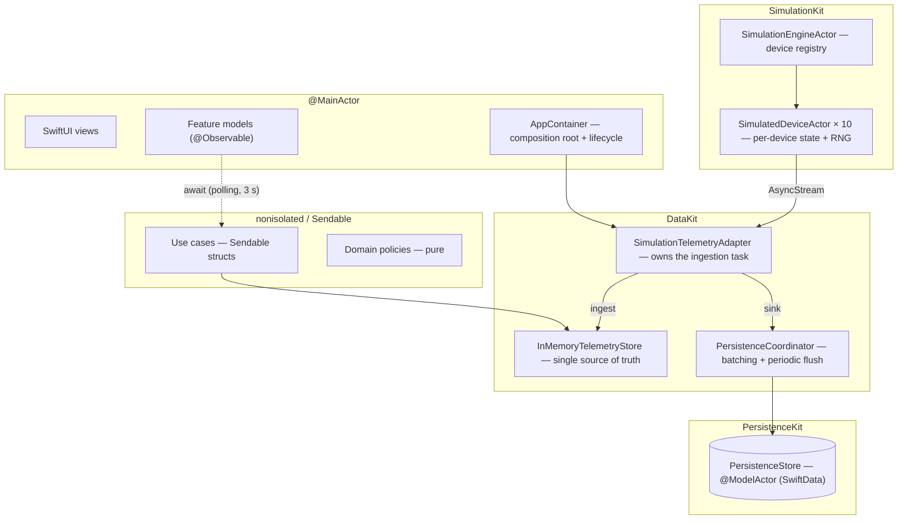

# 7. Concurrency Design

Every target builds in the **Swift 6 language mode**, so complete strict-concurrency checking is on
and data races between isolation domains are compile errors. The goal is not to use actors for show,
but to give each piece of mutable state exactly one owner. This document describes the isolation
model **as implemented**, including the trade-offs it deliberately makes.

## 7.1 The isolation map

| Component | Isolation | Why |
| --- | --- | --- |
| Views, feature models, `AppContainer` | `@MainActor` | UI state mutates on the main actor; Observation drives re-render |
| Domain entities, policies | `Sendable` value types | Immutable data crosses every boundary freely |
| Use cases (`FetchFleetOverviewUseCase`, …) | `Sendable` structs, `async` | Orchestration with no state of their own; independent reads use `async let` |
| `SimulatedDeviceActor` | `actor` | Owns one device's signal models, state machines and seeded RNG |
| `SimulationEngineActor` | `actor` | Owns the mutable device registry |
| `SimulationTelemetryAdapter` | `actor` | Owns the single background ingestion `Task` and its lifecycle |
| `InMemoryTelemetryStore` | `actor` | Owns catalog, latest values, bounded history, events, alert lifecycle |
| `PersistenceCoordinator` | `actor` | Owns the write buffers and the periodic flush task |
| `PersistenceStore` | `@ModelActor` | Serializes SwiftData access off the main actor; `@Model` objects never leave it |
| `CriticalAlertActivityService` | `actor` | Owns the tracked Live Activity |
| `Store*Repository` | `Sendable` structs | Stateless adapters that forward port calls to the store actor |

Rule of thumb: **mutable shared state ⇒ actor; data ⇒ `Sendable` value type; UI ⇒ `@MainActor`.**

## 7.2 The telemetry pipeline

1. **Production.** `SimulationEngineActor.makeFleetStream()` returns an `AsyncStream` fed by a
   `withTaskGroup` with one child per device. Each child runs the free function `pumpDevice`, so every
   `await device.advance()` hops to *that device's* actor: devices simulate concurrently instead of
   serializing on the engine. Pacing comes from an injected `SimulationClock`.
2. **Ingestion.** `SimulationTelemetryAdapter` consumes the stream in one background task and folds
   each item into `InMemoryTelemetryStore`, then hands it to an optional `sink` (the persistence
   coordinator). The task closure captures only `Sendable` values, never `self`, so there is no
   retain cycle.
3. **Persistence.** `PersistenceCoordinator` buffers readings and events and flushes them to the
   `@ModelActor` in batches of 256, plus every 5 s, plus once on stop.
4. **Presentation.** Feature models re-read through the domain ports on a fixed cadence (see 7.4).

### Buffering and back-pressure — an explicit non-goal

The streams use `AsyncStream`'s **`.unbounded`** buffering policy, and there is **no back-pressure**.
That is a conscious trade-off for this data source: the producer is paced by the simulation clock
(one tick per device every 100 ms at the default 600× time scale) and the consumer is an in-memory
actor fold that is far faster than that, so the buffer stays near empty in practice. A real network
source would change this: it would need a bounded policy (e.g. `.bufferingNewest(n)` per device,
keeping the latest values) and coalescing before the store.

## 7.3 Lifecycle and actor reentrancy

Actors serialize *execution*, not *operations*: every `await` inside an actor method is a point
where another call can interleave. Two lifecycle paths are written specifically for that:

- **`SimulationTelemetryAdapter.stop()`** detaches the running task *synchronously* (before its first
  suspension), cancels it, and then waits for it to finish. `start()` first waits for any stopped
  session that is still draining. So a `start()` that lands while a `stop()` is suspended starts a new
  session instead of being dropped, and two ingestion loops never drive the shared device actors at
  the same time.
- **`AppContainer.start()` / `stop()`** are called from several places at once (`RootView.task` and
  the scene-phase handler both start the app at launch). They are appended to a chain of tasks
  synchronously, so they run strictly in call order; overlapping `start()`s can't both observe
  `didBootstrap == false` across the bootstrap `await`.
- **`PersistenceCoordinator.stopAndFlush()`** waits for an in-flight periodic flush before the final
  one, so an older snapshot can't be written after the newer one.

Each of these has a regression test (`DataKitConcurrencyTests`, `AppContainerTests`) that
reproduces the interleaving deterministically, with continuations or real call patterns rather than
sleeps.

**What the ordering relies on.** The chain fixes the order at the moment `start()`/`stop()` is
entered. The scene-phase handler wraps each call in its own `Task {}`. Those tasks inherit the main
actor and are created from it in sequence at the same priority, so they enter the container in creation
order. That is the one runtime assumption left; the rapid-transition test exercises it with that exact
call pattern. Lifecycle work runs in unstructured tasks on purpose: cancelling the view `.task` that
asked for a `start()` doesn't abandon a half-finished bootstrap. A restore that fails at bootstrap is
not retried. The catalog is already registered, so the app runs on fresh telemetry, and by the next
foreground the live state is newer than the snapshot.

## 7.4 Presentation: polling, not stream observation

Screens start a loop from SwiftUI's `.task` (`model.observe()`), which re-reads the ports every 3 s
until the view disappears and the task is cancelled. Live Activity reconciliation (4 s) and watch
sync (5 s) follow the same pattern.

This is a deliberate simplification. The store does not publish a change stream; polling keeps the
features ignorant of how and when data arrives, makes refresh cadence explicit, and gives
cancellation for free through `.task`. The cost is redundant reads when nothing changed and up to one
interval of latency. The natural next step would be an `AsyncStream` of store-change notifications
that the models iterate inside the same `.task`.

## 7.5 Structured concurrency

- **Fan-out.** `SimulationEngineActor` (one child per device) and `InsightsModel` (one insight per
  device) use task groups, so cancelling the parent cancels every child.
- **Independent reads.** Use cases issue independent port calls with `async let` (e.g.
  `FetchDeviceDetailUseCase`, `GenerateDeviceInsightUseCase`).
- **Unstructured tasks** exist only where something must outlive a call and is owned by an actor that
  can cancel it: the adapter's ingestion task, the coordinator's flush task, the stream producers
  (cancelled from `onTermination`), and the container's lifecycle chain.

## 7.6 Cancellation strategy

| Level | Mechanism |
| --- | --- |
| View lifetime | `.task` cancels the model's polling loop on disappear |
| Streams | `onTermination` cancels the producing task; `AsyncStream` iteration ends when the consumer is cancelled |
| Simulation loop | `SimulationClock.awaitTick` throws on cancellation (`Task.sleep` / `Task.checkCancellation`) |
| Ingestion | The loop checks `Task.isCancelled` before each store write; `stop()` awaits completion |
| Fan-out | Task groups propagate cancellation to children |
| Networking | `APIClient` checks cancellation before each attempt and never retries `.cancelled` |

## 7.7 `Sendable` discipline and escape hatches

- Domain entities are `struct`s whose stored properties are all `Sendable`; ports are
  `protocol …: Sendable`.
- `@Model` classes are not `Sendable` and never leave `PersistenceStore`; the actor speaks only domain
  values.
- **`@unchecked Sendable` appears exactly twice**: `PhoneSnapshotSync` and `WatchSnapshotReceiver`,
  the `NSObject` subclasses that bridge `WCSessionDelegate`. Both hold only immutable state, and both
  are documented at the declaration.
- The package builds with zero warnings under Swift 6 mode.

## 7.8 Determinism

- **`SimulationClock`** separates *simulated instants* (pure: tick → date) from *pacing*.
  `ImmediateSimulationClock` runs as fast as the consumer allows (tests); `AcceleratedSimulationClock`
  sleeps (the app).
- **Seeded RNG** (`SeededRandomNumberGenerator`) makes each device's telemetry, and the fleet's ids,
  reproducible.
- **Readiness signals instead of sleeps.** `startAndWaitUntilFirstIngestion()` resumes on a
  continuation when the first reading lands, so tests wait for an event rather than for time.

The few remaining `Task.sleep` calls in tests exercise wall-clock pacing itself (the accelerated
clock and cancellation of a slow stream). See [Testing Strategy](09-testing-strategy.md).
