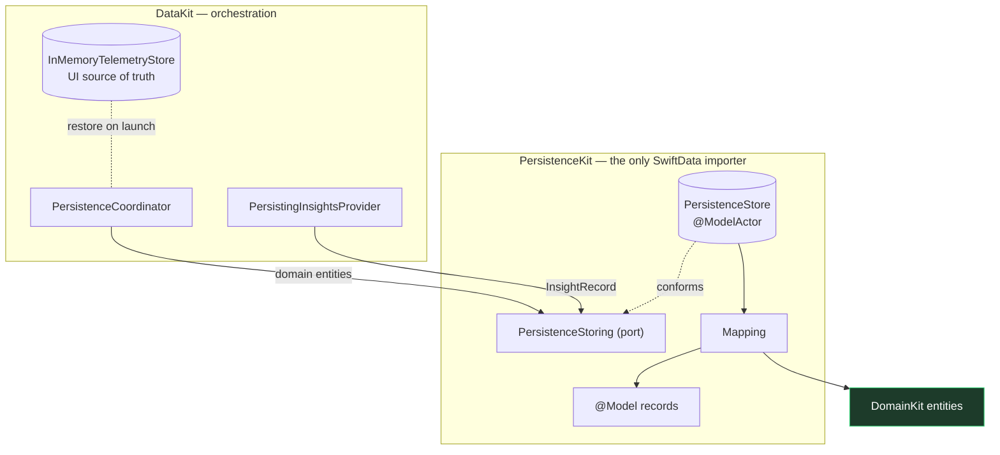

# 21. SwiftData Persistence

`PersistenceKit` makes SignalFlow **offline-first and durable**: assets, devices, telemetry history,
events, alerts, and insight history survive relaunch, restored instantly on startup while the
simulation continues on top. It is the **only** module that imports SwiftData.

```
swift build ✅   swift test → 117 tests, 28 suites ✅   ./Scripts/check-boundaries.sh ✅
xcodebuild -scheme SignalFlow -sdk iphonesimulator … → ** BUILD SUCCEEDED ** ✅
```

## 21.1 Why SwiftData

- **First-party, zero dependencies** — consistent with the project's no-third-party rule.
- **Swift 6 native concurrency** — SwiftData's `ModelActor` gives a first-class way to do all storage
  work off the main actor with compiler-enforced isolation, which is exactly the model this project
  is built to demonstrate.
- **Migration-friendly** — the schema is all primitives (domain enums encoded as strings), so future
  `VersionedSchema`/`SchemaMigrationPlan` steps stay simple.

## 21.2 Architecture & boundaries



- **`DomainKit` never knows SwiftData exists.** PersistenceKit depends on DomainKit alone; `@Model`
  records are `internal` and never leave the actor. Every method on the port speaks `DomainKit` value
  types, mapped at the boundary by `Mapping`.
- **`DataKit` remains the orchestration layer.** It owns the in-memory store (the UI's fast read
  source) and a `PersistenceCoordinator` that mirrors writes to storage; it talks to PersistenceKit
  through the `PersistenceStoring` **port**, never SwiftData.
- **Feature modules are unchanged** — they still consume only `DomainKit` ports.
- The boundary check enforces both new rules: **only `PersistenceKit` may import `SwiftData`**, and
  `PersistenceKit` may import **`DomainKit` only**.

## 21.3 Why a dedicated ModelActor

`PersistenceStore` is a **`@ModelActor`**. That decision carries weight:

- **No persistence on the main actor.** The `@ModelActor` macro gives the store its own `ModelContext`
  on a dedicated executor. All fetches, inserts, saves, and pruning run off-main, so a burst of
  telemetry never blocks the UI.
- **Race-free by construction.** Actor isolation serializes concurrent access with no locks and no
  `@unchecked Sendable`. A test fires 200 concurrent appends and asserts nothing is lost.
- **`@Model` objects never escape.** They're reference types and not `Sendable`; confining them to the
  actor and returning only `DomainKit` value types is what keeps Swift 6 strict concurrency happy and
  the architecture clean.

## 21.4 Offline-first strategy

The in-memory store stays the UI's source of truth (fast, synchronous reads via the repositories);
SwiftData is the durable backing.

- **On launch** (`SimulatedDataSource.bootstrap()`): register the simulated catalog, then restore the
  last persisted **snapshot** — last-known device state, the *latest* reading per metric, active
  alerts, recent events, and recent insights — into the in-memory store. The fleet is therefore shown
  with real data the instant the app opens, before any new telemetry arrives. If the restore fails,
  bootstrap reports `RestoreOutcome.failed` and the app runs degraded on fresh telemetry; if the
  container itself can't be created, the app runs in memory only (both are visible, see
  [App Shell §18.4](18-app-shell.md#failure-handling)).
- **While running:** the `PersistenceCoordinator` buffers high-volume readings/events and flushes them
  in batches off the hot path; each flush also snapshots low-volume device state and active alerts. A
  periodic flush keeps storage fresh, and a final flush runs on stop.
- **Insights** are captured by a `PersistingInsightsProvider` decorator — every generated insight is
  recorded in memory and persisted, transparently wrapping either the Foundation Models or
  deterministic provider.

Because the simulation is fully deterministic (seeded RNG + **seed-derived, stable device/asset IDs**)
and persistence is keyed on stable ids, restore lines up exactly and re-ingestion is **idempotent** —
relaunching reproduces the same dataset rather than duplicating it. Restore loads the *latest*
snapshot for instant display; the full history is kept durably for retention and future use, and the
charts rehydrate from the continuing simulation.

### When a write fails

A failed reading or event append is kept and sent again by the next flush (batch, periodic or the
final one). Retrying is safe because appends are idempotent by id, which holds even after a partial
write:

- `save()` commits a context's pending changes in one SQLite transaction. `appendReadings` saves
  twice (inserts, then retention pruning), so a failure can leave the inserts committed and the
  pruning not; the retry finds those ids and only prunes.
- A failed `save()` rolls the context back, so a failed write leaves nothing pending: the retry
  starts from the last committed state, pending changes can't pile up while writes keep failing,
  and items the coordinator has dropped are never committed by a later save.
- Each insert is preceded by a fetch by id (which also sees inserts made earlier in the same call),
  and `id` is `@Attribute(.unique)` on every record, so the store keeps at most one row per id.
- A flush takes its batch before its first suspension, so overlapping flushes on the reentrant actor
  never hold the same item.

Tests pin this down: against a real in-memory store, a retried batch after a partial commit stores
each item once and a failed save leaves nothing to be committed later; with an injected failing store a failed flush is retried, a partial write is
re-sent without duplicates, overlapping flushes neither lose nor duplicate items, the retry buffer
stays bounded, and `stopAndFlush()` returns while writes fail.

**What this doesn't guarantee.** Unsaved items live only in memory: if the process ends while writes
are failing, they are lost. The retry buffer keeps the newest 16,384 readings and 16,384 events;
older ones are dropped and counted in the log. Device and alert snapshot writes aren't retained,
since every flush rewrites them. A batch that fails for a reason that persists (for example an
invalid record) keeps failing and stays in the retry buffer until it is dropped as the oldest.
Overlapping flushes can commit in either order; reads sort by timestamp, so order doesn't matter to
them. Failures are logged, not shown in the UI. Durable delivery would need an outbox, which is out of scope.

## 21.5 Retention strategy

Row counts are bounded regardless of how long the app runs. Caps (in `RetentionPolicy`, enforced on
flush):

| Data | Policy | Rationale |
| --- | --- | --- |
| Telemetry readings | most recent **2,000 per device-and-metric** | The high-volume table; a per-series rolling window keeps charts useful while bounding total rows (~10 devices × ~3 metrics). |
| Device events | most recent **1,000 per device** | Bounded, low volume. |
| Insights | most recent **200 per device** | A useful history without growth. |
| Active alerts | **active-only**, replaced per device | Captures raise/clear/acknowledge; naturally tiny. |

Pruning uses a `FetchDescriptor` with `fetchOffset = cap` sorted newest-first, deleting everything past
the cap — touching only the series written in the batch. A test caps a series at 10, appends 25, and
asserts exactly the 10 most recent survive.

These caps bound the rows, not the file. SwiftData also records every insert and delete in its
persistent history, which the persistence coordinator trims about once a minute. With both, the file
stays flat under continuous writes. See [§21.9](#persistent-history).

## 21.6 Concurrency model

- Swift 6 strict concurrency throughout; **no `@unchecked Sendable`**, no actor violations, no
  main-actor persistence.
- `PersistenceStore` (ModelActor) owns all SwiftData state; `PersistenceCoordinator` (actor) owns the
  write buffers; the in-memory store (actor) owns the read model. Everything crossing a boundary is a
  `Sendable` `DomainKit` value type.
- The coordinator's background flush task captures only Sendable values and is cancelled on stop, then
  performs a final flush — the same leak-free, cancellation-safe pattern as the ingestion adapter.
- **Containers are created one at a time.** `PersistenceController` holds a lock around
  `ModelContainer(...)`, because creating new stores on two threads at once could crash the process
  inside Core Data ([#30](https://github.com/donatogomez/signal-flow/issues/30)). While building a
  new store's tables, Core Data lazily generates trigger SQL for its persistent-history entities
  (`TRANSACTION`, `CHANGE`, `TRANSACTIONSTRING`). Those entities' metadata is shared by every
  container in the process, whatever its schema or configuration, and the lazy step isn't
  synchronized. Only the first new-store creations in a process were exposed; opening an existing
  store doesn't generate triggers. The lock covers only creation, which is synchronous and rare in
  the app, so reads and writes are unaffected.
  [`ContainerCreationStress`](../Benchmarks/ContainerCreationStress/main.swift) reproduces it: on an
  M1 Pro with macOS 26.3 and 8 threads, 8 of 1,000 processes crashed with in-memory stores and 19 of 500 with on-disk ones
  before the lock, and none in the same counts after it.

## 21.7 Testing

Deterministic tests over real SwiftData stores: **in-memory** containers, except the history tests,
which use **on-disk** stores because history is a property of the store file:

- **Model mapping** — every entity round-trips domain → record → domain, including custom metric/event
  kinds and alert acknowledgement state.
- **Persistence round-trip** — written entities come back through `loadSnapshot`; idempotent re-append,
  including a batch re-sent after part of it was committed; a failed save leaves nothing pending.
- **Actor isolation** — 200 concurrent appends, serialized, nothing lost.
- **Concurrent creation** — stores created at the same time are independent and usable. It can't
  catch the creation crash itself (see §21.6), which only a process's first creations were exposed to.
- **Restoration** — a second data source over the same store restores the fleet, latest telemetry, and
  last-known connectivity end-to-end; insight history survives.
- **Retention** — a capped series prunes to the most recent N.
- **Persistent history** ([§21.9](#persistent-history)) — on an empty store, on history left by an
  earlier launch, and on a backlog deleted in steps; records and the restored snapshot unchanged
  after trimming and after a reopen; history bounded over repeated cycles; a reader on a second
  container during trims; a failed deletion keeps its cutoff. The coordinator's tests cover the
  interval, the backlog and a failed trim.

CI stays deterministic: in-memory storage or a temporary directory per test, stable seed-derived ids,
no wall-clock dependence.

## 21.8 What is intentionally **not** persisted

UI state (selected device, search text, sort/filter, navigation) is **not** persisted — it belongs to
the presentation layer and SwiftUI restores it where appropriate. Persistence is for *facts*: the
fleet, its telemetry, and what was alerted/observed/inferred.

## 21.9 Write-path cost and store growth

**How it was measured.** `swift run -c release PersistenceWriteBenchmark`
([source](../Benchmarks/PersistenceWriteBenchmark/main.swift)) writes to an on-disk store through
`PersistenceStore.appendReadings`. The live shape is 10 devices × 3 metrics in batches of 256, with the
default retention of 2,000 per series, so 60,000 rows at steady state. It reports medians of 20–21
batches. `--extra N` writes N more readings and prints the file size as it goes; `--trim-every N`
trims history every N batches of that phase, as the app does; `--keep` leaves the store on disk for
inspection; `--trim-store PATH` trims an existing store's history, as the first launch after an update
does; `--ingest-store PATH` writes into an existing store at the live rate while trimming. Numbers are from an M1 Pro, release build, two runs; no iPhone has been
measured.

| Batch of 256 readings | Median | Per reading |
| --- | ---: | ---: |
| Empty store | 135–141 ms | ~0.54 ms |
| Steady state, 30 series (the live case) | 314–329 ms | ~1.25 ms |
| The same batch again (a retry: every id found, nothing inserted) | 177–183 ms | ~0.70 ms |
| Steady state, one series (one prune) | 156–162 ms | ~0.62 ms |

- **Lookup by id.** `appendReadings` fetches each id before inserting, to stay idempotent. `id` is
  `@Attribute(.unique)`, so SQLite already has an index on it (`Z_ReadingRecord_UNIQUE_id`). The cost is
  ~0.5 ms per fetch, and it is the same on an empty store as at 60,000 rows. It is the overhead of one
  `FetchDescriptor` round trip, not a missing index. An `#Index` on `id` would duplicate the existing
  one, so it is not added.
- **Insert throughput.** ~780–820 readings/s in the live case, against 300 readings/s produced, so
  ~2.6× headroom. A flush takes ~320 ms of the ~850 ms that 256 readings take to arrive.
- **Retry overhead.** A full retry of a committed batch costs ~55% of a fresh one and inserts nothing,
  so idempotency holds.
- **Pruning.** It adds ~175 ms to a 30-series batch: the difference between the empty store, where
  nothing is pruned, and the steady state.
- **Memory.** The process footprint stays at ~8 MB through the fill and steady state; batches don't
  accumulate in memory.

**Decision.** No schema change or migration. The id index already exists, and the write path has
headroom at the live rate. If it is ever needed, the cheaper change is in code: one fetch per batch
(`ids.contains($0.id)`) instead of one per reading. It is not done now because nothing needs it.

### Persistent history

**Root cause.** SwiftData's default store records a history transaction for every save, with one
change row per insert, update and delete, alongside the data. Nothing turns this on in SignalFlow, and
`ModelConfiguration` has no option to turn it off. Apple's documentation says the app must remove
stale transactions itself ("determine a suitable clean-up strategy"), and gives
`ModelContext.deleteHistory(_:)` for it (iOS 18 / macOS 15). Before this change nothing deleted it.
Retention prunes readings, but every prune is itself recorded, so history grew by ~70 bytes per
reading while the rows stayed at 60,000.

**Who reads history.** Nothing in SignalFlow. There is no `fetchHistory` outside the trim, and no
history token is stored anywhere. The widgets, App Intents and the watch's App Group fallback read
through `WidgetSnapshotReader.shared()`, which opens a new container and does one fresh fetch per
read. The watch on a real device gets its snapshot over WatchConnectivity, not from the file. No
`mainContext`, `@Query` or long-lived context depends on history to merge changes. Deleting history
only makes older tokens expire (`SwiftDataError.historyTokenExpired`), and no code holds one.

**Strategy.** `PersistenceStore.trimHistory()` runs on the store's `ModelActor`, off the main actor,
and uses only public API. It never deletes a record.

1. The first call after launch takes a cutoff: the token of the newest transaction. It deletes
   nothing.
2. Later calls delete `token < cutoff`, the oldest first and at most 1,000 transactions per call
   (`HistoryDescriptor` with `#Predicate { $0.token < cutoff && $0.transactionIdentifier < bound }`).
   A call returns `true` while older history remains.
3. When none remains, the newest transaction becomes the next cutoff.

`PersistenceCoordinator` calls it after a flush: on the first flush, then at most once per
`historyTrimInterval` (60 s), and on every flush while a backlog remains. A failed trim is logged.
It doesn't affect writes, keeps its cutoff, and is retried on the next interval.

**Retention window.** Every transaction made since the cutoff was taken is kept. That is at least
one interval and at most two, plus everything since launch until the first deletion ~60 s in.

60 s is not derived from a consumer, because there is none. It is a margin and a cost trade-off. It
is ~400 times longer than a widget snapshot read (~145 ms), it keeps the history at ~2 MB at the
live rate, and a steady-state trim costs a median of 46 ms once a minute. A shorter interval would
cost more fetches for little disk. A longer one keeps more history and makes each deletion bigger.

A session that ends before its second trim deletes nothing, so its history stays until a later
session runs past ~60 s. That is at most what it wrote in that time, ~1.3 MB at the live rate. A test
covers five such sessions followed by a longer one, which deletes all of it. Suspension doesn't
reset the interval, because the coordinator measures it with `ContinuousClock`.

**Before and after** (M1 Pro, release, the same workload: fill to 60,000 rows, then 512,000 more
readings at steady state; one run each):

| | No trimming | Trimming every 70 batches (~60 s live) |
| --- | ---: | ---: |
| Database file at +51,200 → +512,000 readings | 21.4 → 53.8 MB | 14.3 → 13.8 MB, flat from +102,400 |
| Write-ahead log during the run | 3.0–3.2 MB | 1.0–4.1 MB |
| History tables (dbstat), end of run | 43.0 MB, 1,236,092 changes | 2.0 MB, 56,576 changes |
| Readings table with indexes | 10.6 MB | 10.6 MB |
| Free pages, end of run | 0.02 MB | 1.2 MB |
| Live-case batch, median of 21 | 310.7 ms | 306.0 ms |
| Trim | — | 28, median 45.9 ms, slowest 284.8 ms |
| Footprint, end of run | 8.7 MB | 8.6 MB |
| Widget snapshot read through a new container, median of 7 | 141.6 ms | 156.5 ms |

Logical retention, reclaimable pages and file size are three different things here. History rows
are deleted at once. Their pages go to SQLite's free list and are reused by later writes. The file
shrinks only when Core Data's post-save maintenance runs `incremental_vacuum`, which its debug log
shows it doing above a size threshold. That threshold is internal and undocumented. The WAL is
checkpointed by Core Data and stays a few MB. Opening a new container on the file takes ~10 ms in a
fresh process.

**History from before this change.** A store that ran without trimming carries all of it. The first
trim after the update takes the cutoff, and from ~60 s on the backlog is deleted 1,000 transactions
per flush:

| Store | History | Steps | Per step (median / slowest) | Peak footprint | Largest WAL | File |
| --- | ---: | ---: | ---: | ---: | ---: | ---: |
| The no-trimming benchmark's | 1.24 M changes, 43 MB | 5 | 294 / 309 ms | 15 MB | 3.1 MB | 56 → 39 MB |
| A simulator store from months of runs | 23.0 M changes, 902 MB | 249 | 125 / 281 ms | 56 MB | 12.6 MB | 961 → 28 MB |

Deleting the simulator store's backlog in one transaction instead took 33.9 s, with a 103 MB peak
and a 906 MB WAL. That was the first version of this change, and it is why deletion is done in
steps. In steps, the actor is never held longer than a step (~0.3 s, inside the ~850 ms flush
budget), the WAL stays small, and an interruption loses at most one step. In the app, a backlog of
249 steps took ~3.5 minutes of foreground use to clear in the simulator.

**Interruption.** Each step is one SQLite transaction.

- **One-transaction deletion** (the first version, 1.24 M changes), process killed with `SIGKILL` at
  several points. Before the commit, the store reopened with every change still there. Just after
  it, with 6.9 MB of WAL not yet checkpointed, the deletion was complete.
- **Deletion in steps** (the 23.0 M-change store), killed 3, 12 and 25 s in. 21.3 M, 16.5 M and
  9.4 M changes were left, so the finished steps were kept.

In every case `PRAGMA integrity_check` returned `ok`, the 60,000 readings and 8,417 events were
intact, and reopening and trimming finished the job.

**Writing while a backlog is deleted.** `--ingest-store` writes at the live rate (256 readings every
~853 ms) on the store's own 30 series while trimming like the coordinator. A batch's latency runs
from the arrival of its last reading to the end of its flush, so queueing counts.

| Backlog | Throughput | Flush, write + trim (p50 / p95 / max) | Latency from arrival (p50 / p95 / max) | Most readings waiting | Step (p50 / p95 / max) |
| --- | ---: | ---: | ---: | ---: | ---: |
| 23.0 M changes, 249 steps, 332 s run | 300/s | 499 / 683 / 974 ms | 512 / 696 / 992 ms | one batch | 162 / 279 / 369 ms |
| 1.24 M changes, 256 per transaction, 5 steps | 299/s | 328 / 368 / 678 ms | 352 / 386 / 692 ms | one batch | 349 / 355 / 355 ms |

Throughput kept up with the 300 readings/s produced, and no flush started with more than the one
batch that had just arrived, so the queue never grew. On the large store, the slowest flush took
974 ms, longer than a batch interval. The next batch waited behind it, and the queue drained on the
following flush. Peak footprint was 38 MB and the largest WAL 10 MB.

Readings written during a backlog are newer than its cutoff. They're kept until the next cutoff,
one interval after the backlog ends.

**Step size.** A step is 1,000 transactions, and the cost follows the changes in them.

- **The simulator store.** A transaction held 1–510 changes (median 6, 99th percentile 256), so a
  step held 27 k–149 k changes (median 90 k). With writes running alongside, a step took about
  32 ms + 1.5 ms per 1,000 changes, a loose fit (r = 0.36).
- **The densest store measured.** Every transaction held 256 changes, the size of one save of the
  write path, so a step held 256 k changes. Steps took ~350 ms, and every batch was still written
  within 692 ms of arriving.
- **What would exceed the budget.** A run of 1,000 transactions of ~510 changes, about 0.8 s by the
  fit. The write path doesn't produce that: there were 3 such transactions out of 248,386.

The step stays at 1,000, not smaller and not adaptive.

**Cross-process.** A test keeps a second container open on the same file, as the widget does, and
reads it 60 times while the app's store writes and trims. Every read is whole, and both containers
see the final state. In the iOS 26.5 simulator, the app ran with this change on the 961 MB store
above. Deletion started ~60 s after launch, and the file shrank steadily to 54 MB at 254 s and
24 MB shortly after. The largest WAL was 8 MB, and the app's footprint stayed between 30 and 36 MB.
Afterwards `integrity_check` returned `ok` and every record had survived: 60,000 readings, 8,417
events, 70 insights, 10 devices and 10 assets. The app kept running and updating. An unsigned
simulator build has no App Group, so the run used the app's private fallback store.

**Not verified.**
- **Device.** No iPhone or Apple Watch has been measured. All timings are from an M1 Pro.
- **App Group sharing.** Not exercised with a signed build: that widgets and App Intents read the
  app's trimmed store, and that widget timelines refresh afterwards.
- **iOS lifecycle.** Termination or suspension during a step on iOS (`0xdead10cc` for a file lock held
  in a shared container while suspended). Each step is short and atomic, but this has not been
  observed.
- **Low disk.** A deletion needs WAL space for one step (≤ 13 MB measured). A failure is retried
  every interval.
- **Changes in Apple's implementation.** The vacuum threshold, and SwiftData's own use of history in
  future OS versions.
