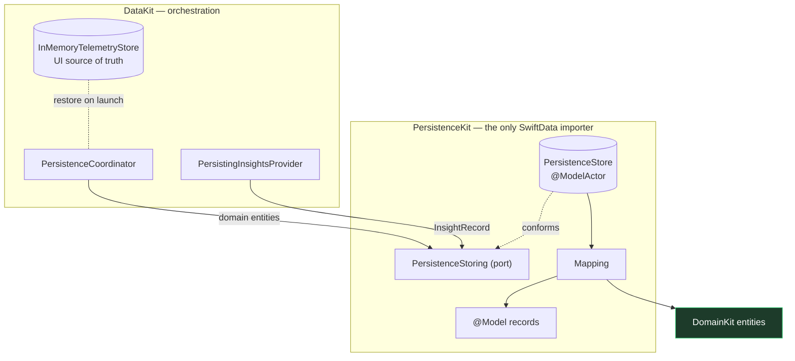

# 21. SwiftData Persistence

`PersistenceKit` makes SignalFlow **offline-first and durable**: assets, devices, telemetry history,
events, alerts, and insight history survive relaunch, restored instantly on startup while the
simulation continues on top. It is the **only** module that imports SwiftData.

```
swift build ✅   swift test → 117 tests, 28 suites ✅   ./Scripts/check-boundaries.sh ✅
xcodebuild -scheme SignalFlow -sdk iphonesimulator … → ** BUILD SUCCEEDED ** ✅
```

## 21.1 Why SwiftData

- **First-party, zero dependencies** — consistent with the project's no-third-party rule.
- **Swift 6 native concurrency** — SwiftData's `ModelActor` gives a first-class way to do all storage
  work off the main actor with compiler-enforced isolation, which is exactly the model this project
  is built to demonstrate.
- **Migration-friendly** — the schema is all primitives (domain enums encoded as strings), so future
  `VersionedSchema`/`SchemaMigrationPlan` steps stay simple.

## 21.2 Architecture & boundaries



- **`DomainKit` never knows SwiftData exists.** PersistenceKit depends on DomainKit alone; `@Model`
  records are `internal` and never leave the actor. Every method on the port speaks `DomainKit` value
  types, mapped at the boundary by `Mapping`.
- **`DataKit` remains the orchestration layer.** It owns the in-memory store (the UI's fast read
  source) and a `PersistenceCoordinator` that mirrors writes to storage; it talks to PersistenceKit
  through the `PersistenceStoring` **port**, never SwiftData.
- **Feature modules are unchanged** — they still consume only `DomainKit` ports.
- The boundary check enforces both new rules: **only `PersistenceKit` may import `SwiftData`**, and
  `PersistenceKit` may import **`DomainKit` only**.

## 21.3 Why a dedicated ModelActor

`PersistenceStore` is a **`@ModelActor`**. That decision carries weight:

- **No persistence on the main actor.** The `@ModelActor` macro gives the store its own `ModelContext`
  on a dedicated executor. All fetches, inserts, saves, and pruning run off-main, so a burst of
  telemetry never blocks the UI.
- **Race-free by construction.** Actor isolation serializes concurrent access with no locks and no
  `@unchecked Sendable`. A test fires 200 concurrent appends and asserts nothing is lost.
- **`@Model` objects never escape.** They're reference types and not `Sendable`; confining them to the
  actor and returning only `DomainKit` value types is what keeps Swift 6 strict concurrency happy and
  the architecture clean.

## 21.4 Offline-first strategy

The in-memory store stays the UI's source of truth (fast, synchronous reads via the repositories);
SwiftData is the durable backing.

- **On launch** (`SimulatedDataSource.bootstrap()`): register the simulated catalog, then restore the
  last persisted **snapshot** — last-known device state, the *latest* reading per metric, active
  alerts, recent events, and recent insights — into the in-memory store. The fleet is therefore shown
  with real data the instant the app opens, before any new telemetry arrives. If the restore fails,
  bootstrap reports `RestoreOutcome.failed` and the app runs degraded on fresh telemetry; if the
  container itself can't be created, the app runs in memory only (both are visible, see
  [App Shell §18.4](18-app-shell.md#failure-handling)).
- **While running:** the `PersistenceCoordinator` buffers high-volume readings/events and flushes them
  in batches off the hot path; each flush also snapshots low-volume device state and active alerts. A
  periodic flush keeps storage fresh, and a final flush runs on stop.
- **Insights** are captured by a `PersistingInsightsProvider` decorator — every generated insight is
  recorded in memory and persisted, transparently wrapping either the Foundation Models or
  deterministic provider.

Because the simulation is fully deterministic (seeded RNG + **seed-derived, stable device/asset IDs**)
and persistence is keyed on stable ids, restore lines up exactly and re-ingestion is **idempotent** —
relaunching reproduces the same dataset rather than duplicating it. Restore loads the *latest*
snapshot for instant display; the full history is kept durably for retention and future use, and the
charts rehydrate from the continuing simulation.

### When a write fails

A failed reading or event append is kept and sent again by the next flush (batch, periodic or the
final one). Retrying is safe because appends are idempotent by id, which holds even after a partial
write:

- `save()` commits a context's pending changes in one SQLite transaction. `appendReadings` saves
  twice (inserts, then retention pruning), so a failure can leave the inserts committed and the
  pruning not; the retry finds those ids and only prunes.
- A failed `save()` rolls the context back, so a failed write leaves nothing pending: the retry
  starts from the last committed state, pending changes can't pile up while writes keep failing,
  and items the coordinator has dropped are never committed by a later save.
- Each insert is preceded by a fetch by id (which also sees inserts made earlier in the same call),
  and `id` is `@Attribute(.unique)` on every record, so the store keeps at most one row per id.
- A flush takes its batch before its first suspension, so overlapping flushes on the reentrant actor
  never hold the same item.

Tests pin this down: against a real in-memory store, a retried batch after a partial commit stores
each item once and a failed save leaves nothing to be committed later; with an injected failing store a failed flush is retried, a partial write is
re-sent without duplicates, overlapping flushes neither lose nor duplicate items, the retry buffer
stays bounded, and `stopAndFlush()` returns while writes fail.

**What this doesn't guarantee.** Unsaved items live only in memory: if the process ends while writes
are failing, they are lost. The retry buffer keeps the newest 16,384 readings and 16,384 events;
older ones are dropped and counted in the log. Device and alert snapshot writes aren't retained,
since every flush rewrites them. A batch that fails for a reason that persists (for example an
invalid record) keeps failing and stays in the retry buffer until it is dropped as the oldest.
Overlapping flushes can commit in either order; reads sort by timestamp, so order doesn't matter to
them. Failures are logged, not shown in the UI. Durable delivery would need an outbox, which is out of scope.

## 21.5 Retention strategy

Row counts are bounded regardless of how long the app runs. Caps (in `RetentionPolicy`, enforced on
flush):

| Data | Policy | Rationale |
| --- | --- | --- |
| Telemetry readings | most recent **2,000 per device-and-metric** | The high-volume table; a per-series rolling window keeps charts useful while bounding total rows (~10 devices × ~3 metrics). |
| Device events | most recent **1,000 per device** | Bounded, low volume. |
| Insights | most recent **200 per device** | A useful history without growth. |
| Active alerts | **active-only**, replaced per device | Captures raise/clear/acknowledge; naturally tiny. |

Pruning uses a `FetchDescriptor` with `fetchOffset = cap` sorted newest-first, deleting everything past
the cap — touching only the series written in the batch. A test caps a series at 10, appends 25, and
asserts exactly the 10 most recent survive.

The file is **not** bounded: SwiftData records every insert and delete in its persistent history, and
nothing prunes that history. See [§21.9](#219-write-path-cost-and-store-growth).

## 21.6 Concurrency model

- Swift 6 strict concurrency throughout; **no `@unchecked Sendable`**, no actor violations, no
  main-actor persistence.
- `PersistenceStore` (ModelActor) owns all SwiftData state; `PersistenceCoordinator` (actor) owns the
  write buffers; the in-memory store (actor) owns the read model. Everything crossing a boundary is a
  `Sendable` `DomainKit` value type.
- The coordinator's background flush task captures only Sendable values and is cancelled on stop, then
  performs a final flush — the same leak-free, cancellation-safe pattern as the ingestion adapter.
- **Containers are created one at a time.** `PersistenceController` holds a lock around
  `ModelContainer(...)`, because creating new stores on two threads at once could crash the process
  inside Core Data ([#30](https://github.com/donatogomez/signal-flow/issues/30)). While building a
  new store's tables, Core Data lazily generates trigger SQL for its persistent-history entities
  (`TRANSACTION`, `CHANGE`, `TRANSACTIONSTRING`). Those entities' metadata is shared by every
  container in the process, whatever its schema or configuration, and the lazy step isn't
  synchronized. Only the first new-store creations in a process were exposed; opening an existing
  store doesn't generate triggers. The lock covers only creation, which is synchronous and rare in
  the app, so reads and writes are unaffected.
  [`ContainerCreationStress`](../Benchmarks/ContainerCreationStress/main.swift) reproduces it: on an
  M1 Pro with macOS 26.3 and 8 threads, 8 of 1,000 processes crashed with in-memory stores and 19 of 500 with on-disk ones
  before the lock, and none in the same counts after it.

## 21.7 Testing

16 deterministic tests, all using an **in-memory** `ModelContainer` (no disk):

- **Model mapping** — every entity round-trips domain → record → domain, including custom metric/event
  kinds and alert acknowledgement state.
- **Persistence round-trip** — written entities come back through `loadSnapshot`; idempotent re-append,
  including a batch re-sent after part of it was committed; a failed save leaves nothing pending.
- **Actor isolation** — 200 concurrent appends, serialized, nothing lost.
- **Concurrent creation** — stores created at the same time are independent and usable. It can't
  catch the creation crash itself (see §21.6), which only a process's first creations were exposed to.
- **Restoration** — a second data source over the same store restores the fleet, latest telemetry, and
  last-known connectivity end-to-end; insight history survives.
- **Retention** — a capped series prunes to the most recent N.

CI stays deterministic: in-memory storage, stable seed-derived ids, no wall-clock dependence.

## 21.8 What is intentionally **not** persisted

UI state (selected device, search text, sort/filter, navigation) is **not** persisted — it belongs to
the presentation layer and SwiftUI restores it where appropriate. Persistence is for *facts*: the
fleet, its telemetry, and what was alerted/observed/inferred.

## 21.9 Write-path cost and store growth

**How it was measured.** `swift run -c release PersistenceWriteBenchmark`
([source](../Benchmarks/PersistenceWriteBenchmark/main.swift)) writes to an on-disk store through
`PersistenceStore.appendReadings`. The live shape is 10 devices × 3 metrics in batches of 256, with the
default retention of 2,000 per series, so 60,000 rows at steady state. It reports medians of 20–21
batches. `--extra N` writes N more readings and prints the file size as it goes; `--keep` leaves the
store on disk for inspection. Numbers are from an M1 Pro, release build, two runs; no iPhone has been
measured.

| Batch of 256 readings | Median | Per reading |
| --- | ---: | ---: |
| Empty store | 135–141 ms | ~0.54 ms |
| Steady state, 30 series (the live case) | 314–329 ms | ~1.25 ms |
| The same batch again (a retry: every id found, nothing inserted) | 177–183 ms | ~0.70 ms |
| Steady state, one series (one prune) | 156–162 ms | ~0.62 ms |

- **Lookup by id.** `appendReadings` fetches each id before inserting, to stay idempotent. `id` is
  `@Attribute(.unique)`, so SQLite already has an index on it (`Z_ReadingRecord_UNIQUE_id`). The cost is
  ~0.5 ms per fetch, and it is the same on an empty store as at 60,000 rows. It is the overhead of one
  `FetchDescriptor` round trip, not a missing index. An `#Index` on `id` would duplicate the existing
  one, so it is not added.
- **Insert throughput.** ~780–820 readings/s in the live case, against 300 readings/s produced, so
  ~2.6× headroom. A flush takes ~320 ms of the ~850 ms that 256 readings take to arrive.
- **Retry overhead.** A full retry of a committed batch costs ~55% of a fresh one and inserts nothing,
  so idempotency holds.
- **Pruning.** It adds ~175 ms to a 30-series batch: the difference between the empty store, where
  nothing is pruned, and the steady state.
- **Memory.** The process footprint stays at ~8 MB through the fill and steady state; batches don't
  accumulate in memory.

**Decision.** No schema change or migration. The id index already exists, and the write path has
headroom at the live rate. If it is ever needed, the cheaper change is in code: one fetch per batch
(`ids.contains($0.id)`) instead of one per reading. It is not done now because nothing needs it.

### Persistent history grows without bound

The row count stays at 60,000, but the file keeps growing, by ~3.6 MB per 51,200 readings written
(~70 bytes per reading). It reached 37.9 MB after ~390,000 readings. The kept store shows why:

| Table (with its indexes) | Size | Rows |
| --- | ---: | ---: |
| `ACHANGE`, SwiftData's persistent history | 24.9 MB | 724,092 (392,046 inserts, 332,046 deletes) |
| `ZREADINGRECORD` | 10.5 MB | 60,000 |

SwiftData enables persistent history tracking by default, and records one change for each insert and
each prune delete. Nothing in SignalFlow reads that history: there is no `fetchHistory` call and no
history token. Nothing deletes it either. At the live rate of 300 readings/s, this extrapolates to
roughly 75 MB per hour of foreground use, in the App Group store that the widgets also open. Write cost
moved little over the measured range (314 → 329 ms from 21 to 38 MB), so the problem is disk use, not
speed.

**Proposed fix, not applied (it needs approval).** After each flush, or on a timer, delete history
older than a few minutes with `ModelContext.deleteHistory(_:)` and a `HistoryDescriptor` filtered by
timestamp. It needs no schema change and no migration.

- **Compatibility risk.** SwiftData can use history to merge changes between contexts and processes.
  The widget, App Intents and watch readers each fetch fresh and don't consume history, but this has
  to be confirmed on device. Keeping a recent window instead of deleting everything limits the risk.
- **Testing.** A test that writes past retention and asserts the history count stays bounded. The
  benchmark's `--extra` run must show a flat file size. A device run must show widgets still update.

Until then, the file grows as described, and [§11.2](11-portfolio-value.md#112-known-limitations) lists
it as a known limitation.
